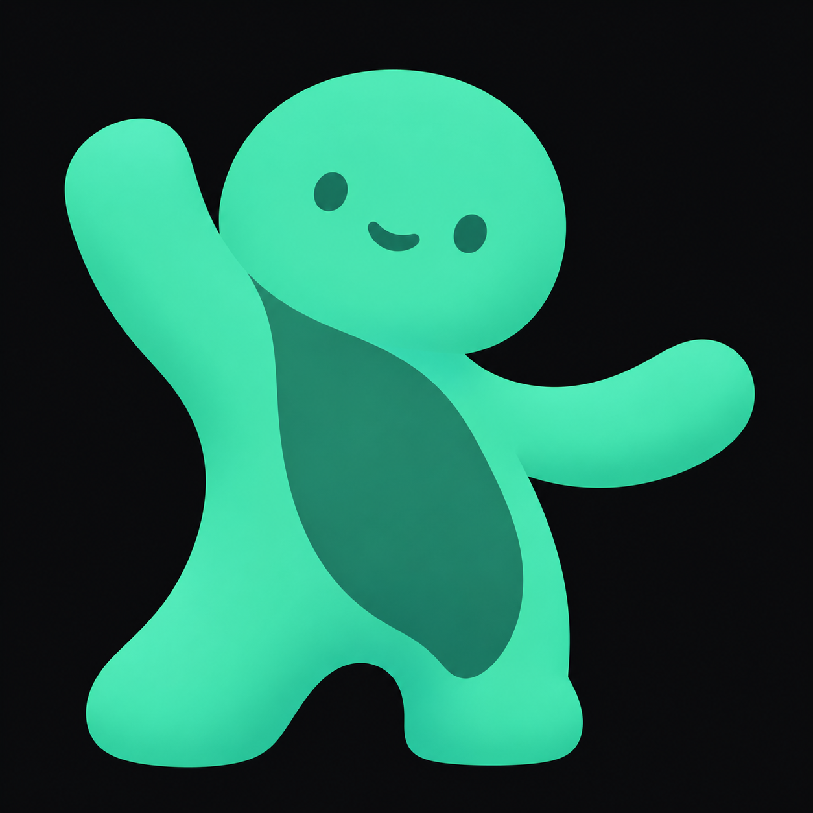
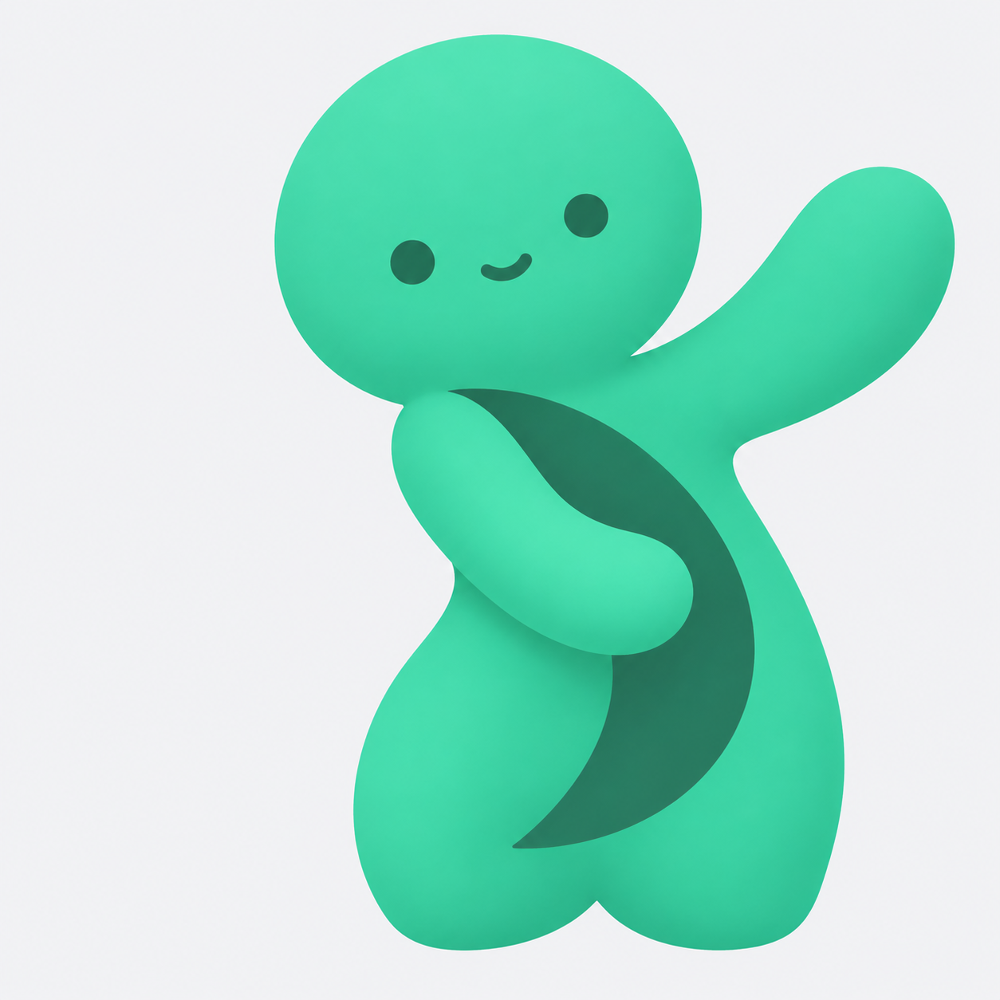
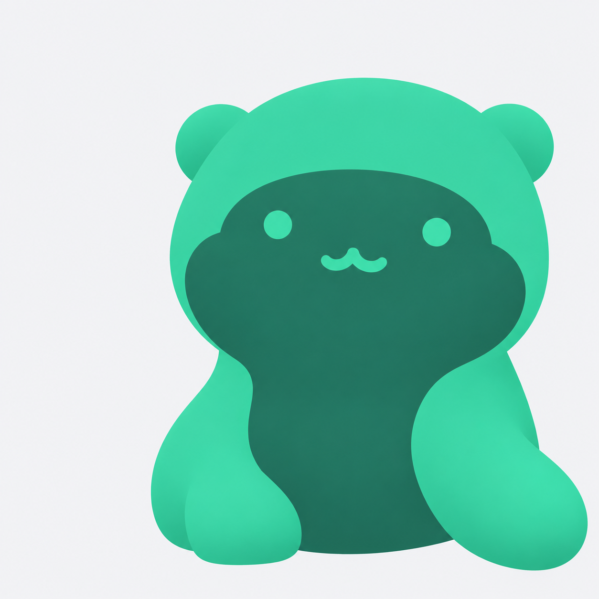
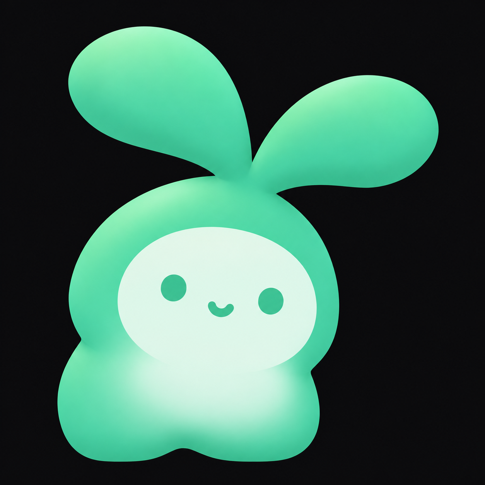
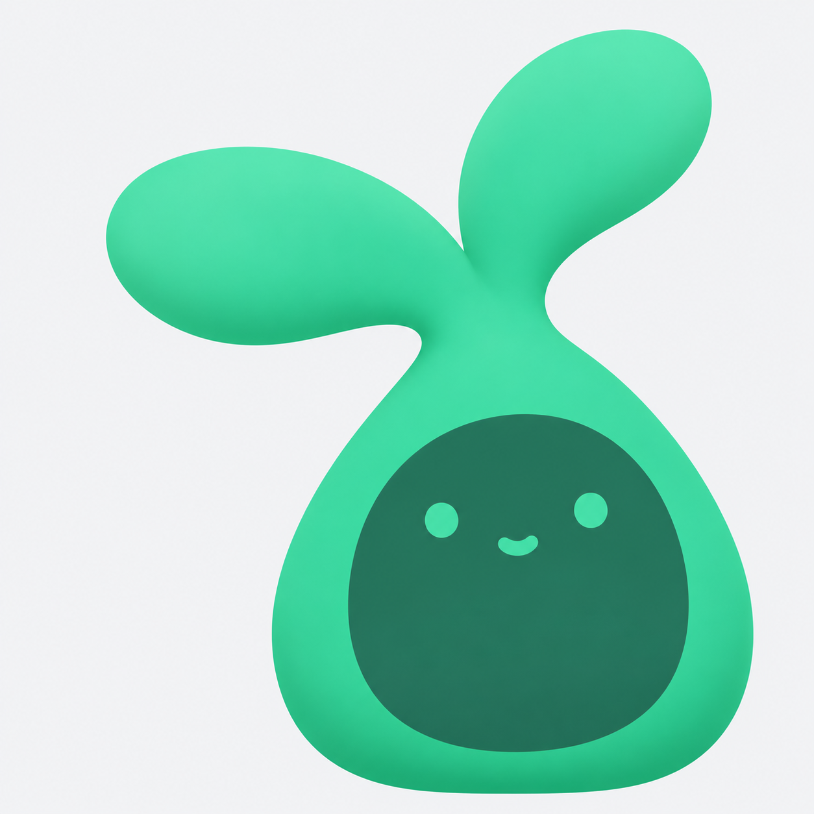

# HipLab 图标候选（2026-10-17）

六张均为独立生成的原生 1254 × 1254 PNG，由用户指定的“设计5个App图标候选”聊天使用 `ip-as-logo` 制作。此目录从设计工作区原字节归档，无重采样或图片后处理；尚未选版，也未替换 App 图标。

| 编号 | 方向 / 背景 | 原图 |
|---|---|---|
| A1 | 舒展精灵 / 石墨底 | [PNG](A1-stretch-sprite-graphite.png) |
| A2 | 舒展精灵 / 暖白底 | [PNG](A2-stretch-sprite-ivory.png) |
| B1 | 灵活小水獭 / 石墨底 | [PNG](B1-otter-graphite.png) |
| B2 | 灵活小水獭 / 暖白底 | [PNG](B2-otter-ivory.png) |
| C1 | 萌芽伙伴 / 石墨底 | [PNG](C1-sprout-graphite.png) |
| C2 | 萌芽伙伴 / 暖白底 | [PNG](C2-sprout-ivory.png) |

完整设计理由和原始提示见 [generation-report.md](generation-report.md)，结构化提示见 [prompts.json](prompts.json)，配色说明见 [brand-color-notes.md](brand-color-notes.md)。这些报告与逐张 metadata 保留设计方原文，其中绝对路径指向原工作区；本页相对链接用于在仓库中查看归档图。来源和逐文件 SHA256 见 [archive-manifest.json](archive-manifest.json)。

选定后再制作 Adaptive 前景/背景、Monochrome、所需尺寸和系统遮罩预览，并完成 Android 构建、覆盖安装与桌面核对。光栅图不等于矢量源；当前批次未宣称矢量或安卓工程资产已完成。产品设计要求见 [Icon brief](../../../docs/app-icon-brief-2026-10-17.md)。

## A1 · 舒展精灵 / 石墨底

## A2 · 舒展精灵 / 暖白底

## B1 · 灵活小水獭 / 石墨底

## B2 · 灵活小水獭 / 暖白底

## C1 · 萌芽伙伴 / 石墨底

## C2 · 萌芽伙伴 / 暖白底

