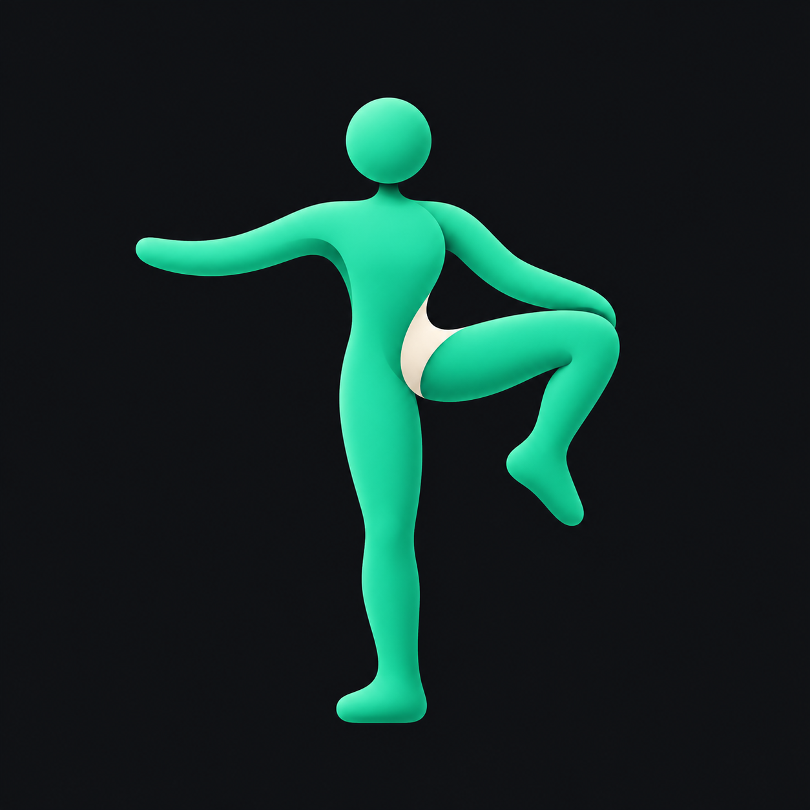

# HipLab 运动图标新方向（2026-10-17）

根据用户新要求，由当前 HipLab 聊天直接制作：简约、有质感、能识别为运动 App，并突出髋部/胯部的舒展柔韧。前轮六个角色 IP 方案已否决，PR #4 已关闭，不作为本轮参考。

两张为内置 ImageGen 独立生成的 1254 × 1254 PNG，原图原字节保存。用户随后选定 B，已制作安卓资源并安装至 0.1.2+3，见[正式图标交付](../launcher-20261017/README.md)。完整提示见 [prompts.json](prompts.json)，来源、尺寸和 SHA256 见 [manifest.json](manifest.json)。具体模型名称未由工具暴露。

## A · 蝴蝶坐姿舒展

两侧腿部形成展开的弧线，髋线以近白色短弧标出，强调柔韧与舒展。视觉更平稳，运动表现偏静态。

## B · 站姿抬膝开髋

单腿支撑、另一腿向外抬膝，髋部转折作为视觉中心，突出活动度和主动控制。当前更推荐沿此构图继续收敛，运动和开髋含义比坐姿版直接。

原计划另有一张侧弓步构图，图像服务在输出阶段拦截，未返回图片，未重试；提示和失败状态如实保留。两个成功结果均已交付，没有将失败任务记成第三张图。

候选 A 保留作历史比较，B 已完成 Android Adaptive/Monochrome、预览与实机桌面核对。正式矢量和 iOS 图标尚未交付；设备端只验证普通彩色图标，单色系统主题为资源与离线预览验证。
