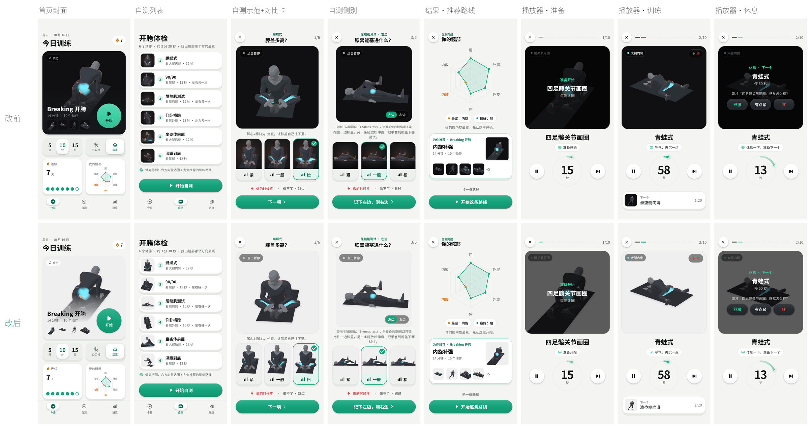
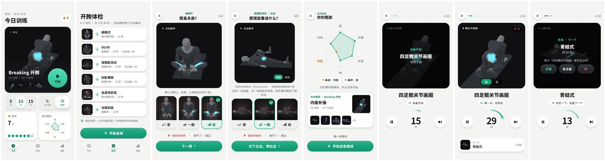
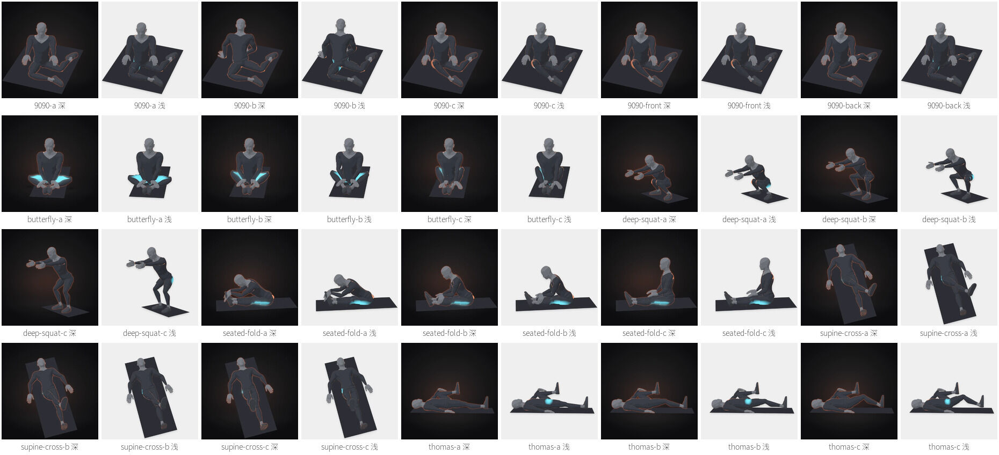
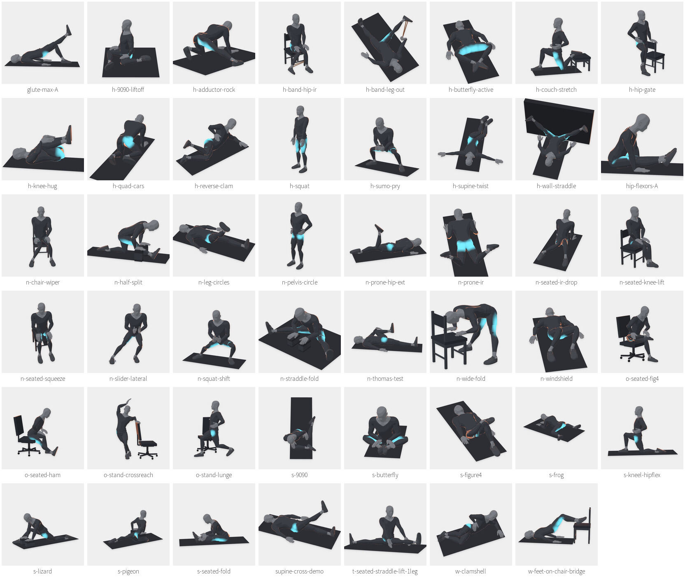

# 动作素材按浅/深主题定制（2026-10-19）

分支 `feat/themed-action-media`（基于 main `6020d8e`）。目标：浅色主题下展示动作时不再出现一块深色背景，视频区、封面、缩略图、自测对比图和页面成为一体；深色主题保持原样。

结论先行：**用同一套 Pose-Hub v0.2.0 透明母帧，离线合成“浅色舞台”版视频/封面/自测图，与现有深色版并排打包；App 按当前主题选文件。**深色主题像素级不变；浅色主题 8 个展示位置全部去掉深色块。新增包体 **+22.7 MB**（47 条视频 21.8 MB、47 张封面 0.57 MB、20 张自测图 0.23 MB、清单 82 KB）。



## 1. 盘点：App 里所有展示动作素材的位置（改前）

截图：`flutter test test_screens/hip_shots_test.dart`，390×844 @2x（flutter_tester 不跑 WebView，视频位显示同帧封面；真机在这些位置播放循环视频）。



| # | 位置 | 组件 / 代码 | 素材 | 显示尺寸 | 改前背景 | 改前 浅色主题效果 | 改后 |
|---|---|---|---|---|---|---|---|
| 1 | 首页封面（今日训练 hero） | `_hero` → `HipMediaFrame` + `HipDrillArt` `lib/hip/ui/hip_app.dart` | 首个动作封面 540² jpg（不播放） | 卡高 350，图 280 高 cover | 写死 `HipPalette.dark` 舞台 | 浅色页上一整块黑卡 | 浅色主题用浅色舞台（卡色 = 视频底色 `#EFEFEF`），“预览”角标改浅色 |
| 2 | 首页封面内动作缩略图 | `HipThumb(40)` + `HipDrillArt` | 封面 540² | 40×40 | `mediaBackdrop` 深 `#141517` | 4 个小黑块 | 浅色封面 + 浅色底 |
| 3 | 自测列表缩略图 | `HipThumb(58)` + `HipFocusImage` `hip_assessment_page.dart` | 自测对比图 webp | 58×58 | 深 | 6 个黑方块 | 浅色对比图 |
| 4 | 自测示范视频区 | `_demo` → `HipMediaFrame` + `HipDrillArt(contain)` | 示范视频 1080²（含 `supine-cross-demo` 剪辑） | 宽满屏、约 0.75 屏宽高 | 深 | 大黑框 | 浅色视频 + 浅色封面 |
| 5 | 自测对比卡（紧/一般/松、90/90 追问） | `_optionCard` → `ColoredBox(HipPalette.dark.mediaBackdrop)` | 自测对比图 webp（540/1080） | 约 110×150 ×3 | 写死深色 | 三张黑卡 | 浅色对比图 + 浅色舞台 |
| 6 | 结果页推荐路线卡缩略图 | `HipThumb` + `HipDrillArt` | 封面 540² | 72 / 40 | 深 | 黑块 | 浅色 |
| 7 | 播放器视频区（准备/训练/休息） | `HipMediaFrame(28)` + `HipDrillArt(cover)` `hip_player_page.dart` | 训练视频 1080² H.264 | 屏宽−32，约 0.8 屏宽高 | 深 | 页面中间一块黑底（参考 `prep-overlay-1.webp`） | 浅色视频，与浅色页一体 |
| 8 | 播放器“下一个”缩略图 | `HipThumb` + `HipDrillArt` | 封面 540² | 48 | 深 | 黑块 | 浅色 |

不涉及：引导页安全卡插图（本来就有 `-light/-dark` 两套 webp）；`assets/hip/posters/*.webp`（旧原型封面，内容包已不引用，本次不动）。

改前素材：深色视频 = Pose-Hub v0.2.0 发布件（透明母帧合成在 `#101013` 上，1080²、30 fps、H.264 High ≈690 kbps、整段一个关键帧）；封面 540² jpg；自测图为 3D-Body r2 渲染的深色舞台 webp。代码里早有 `HipMediaVariants` 和 `player.js` 的 `variant=light` 通道，但没有浅色文件，所以浅色主题一直显示深色舞台。

## 2. 方案比较与选择

| 方案 | 体积（47 条） | 清晰度 | 解码/兼容 | 结论 |
|---|---|---|---|---|
| **A. 每主题一套烘焙好的不透明 H.264（选用）** | 深色不动 + 浅色 21.8 MB | 与深色同为 1080²；SSIM 0.998 | 与现有完全同一路径：WebView `<video>` + H.264 硬解，Android/iOS 都稳 | ✔ 稳健、零新依赖、真机风险最低 |
| B. 透明视频运行时叠主题底 | 需两种格式：Android WebM VP9-alpha、iOS HEVC-alpha（.mov）；单份约为不透明的 1.5–2 倍 | 同 | VP9-alpha 在安卓多为软解（1080p30 低端机吃 CPU、发热）；iOS WebKit 不支持 VP9-alpha，只能 HEVC-alpha，而它只能在 macOS VideoToolbox 编码，Windows 主线做不出来；透明 WebView 合成还有首帧黑闪/混合成本 | ✘ 平台分叉、产线依赖 Mac |
| C. Flutter 播 PNG/WebP 序列 | 每条 240 帧，动画 WebP 约 3–5 MB/条 → 150–230 MB | 好 | 内存/解码压力大 | ✘ 体积不可接受 |
| D. WebView 内 canvas/WebGL 实时抠绿幕 | 0 | 边缘溢色 | 每帧 GPU/CPU，耗电，WebView 差异大 | ✘ |

选 A 的依据：动作是“示范”，不需要和任意背景合成；页面上它总坐在固定的媒体舞台色上，所以把舞台色直接烘焙进视频，既保留硬解和现有播放器（首帧握手、封面淡出、后台恢复都已在真机验证过），又没有透明通道的兼容问题。代价只是包体，见第 4 节。

**浅色舞台色 `#EFEFEF`（中性灰）**：H.264 用 YCbCr 存颜色，若某台设备的解码/合成忽略色彩标签、用 BT.601 而不是 BT.709 反算，带色相的底色会偏（实测原想用的 `#EEF0EE` 在 601 解码下变成 `#E7EDE7`，视频边缘会出现一块发绿的框）。R=G=B 的中性灰在两种矩阵下都是 Cb=Cr=128，解出来的值相同，所以视频底色在任何设备上都等于 Flutter 画的 `HipPalette.light.mediaBackdrop`。47 条浅色视频四角实测全部是 Y=221/U=128/V=128（= `#EFEFEF`）。

**人物对比度**：人物和地垫保持渲染原色（深炭灰衣服 `#2C2E34–#383C44` 对 `#EFEFEF` 为 9.6–11.8:1；浅灰头/手 `≈#787C84` 为 3.6:1，满足 WCAG 非文本 3:1）。另加一层很轻的投影（人物+道具轮廓的 alpha 高斯模糊 σ=12、下移 10 px、不透明度 14%），让浅灰的手和头在浅底上有边，也让人物“落地”而不是漂着。深色版不加投影（保持发布件原样）。



**地垫**：地垫是母帧的一部分（深炭灰平面）。在浅色舞台上读作“浅色地面上的一张黑瑜伽垫”，观感自然；尝试过按颜色把垫子改浅，但会误伤衣服阴影边缘（逐帧会闪），不可靠，没有采用。若要浅色垫，应在 Pose-Hub 出原生 light 变体（v0.2.0 发布说明写明 light 未包含），在 HipLab 不重渲（见 AGENTS 约定）。

**自测对比图**：浅色版取 Pose-Hub 私有归档里 6 套 `a-*` 静态母图（`stills/NN/alpha/pose-NN.png`，pose-01..05 = a/b/c/front/back，已目视核对与现有深色图同姿态同取景）。它们是 Pose-Hub 当前渲染风格（无橙色描边光），深色版仍是原 3D-Body r2 图，所以两主题高亮风格略有差异，姿态与构图一致；`HipFocusImage` 的取景框无需调整。

**`supine-cross-demo`**（仰卧横跨自测示范）是从 `n-leg-circles` 7.2–12.0 s 剪出的 144 帧。打包中的深色剪辑来自更早一批 3D-Body 渲染（与 v0.2.0 母帧同时间轴，PSNR 33 dB，高亮风格略不同）；浅色剪辑用 v0.2.0 母帧的同一帧段（216–359）生成。



## 3. 素材管线 `tools/media/build_themed_media.py`

只用 ffmpeg/ffprobe + Python 标准库，不新增依赖。输入是云盘私有归档（folder `1SYZ1Ww3LRpMX4MZOSZeV6gpWl0Tc7fJe`）里的传输 ZIP，云盘文件一律只读。

```bash
# 1) 由归档 catalog.json 固定输入（每个动作 kind=registered 的 ZIP；视频条目必须与冻结 v0.2.0 绿幕母版 SHA 一致）
python3 tools/media/build_themed_media.py plan --catalog <catalog.json>      # -> tools/media/themed_media_sources.json
# 2) 下载 sources 里列出的 ZIP（gws 或浏览器）到一个目录，然后
python3 tools/media/build_themed_media.py build --zips <dir> [--jobs 2] [--only id,...]
# 3) 校验打包文件与清单逐字节一致（Dart 测试也会做同样的校验）
python3 tools/media/build_themed_media.py check
```

- 只下载 HipLab 用到的 52 个 ZIP（46 个动作 + 6 套自测静态，共 1.98 GB），不整库下载；多 part 的会按顺序全部校验（本批均为单 part）。
- 每个 ZIP 先比对 catalog 的 SHA-256 与字节数，解出的每个成员再比对包内 `SHA256SUMS.txt`。
- **出处校验**：母帧合成到 `#101013` 后与打包的深色发布视频逐帧比对，46 条 PSNR 50.6–56.7 dB（同一渲染、同一时间轴），低于 40 dB 直接失败；剪辑条目阈值 30 dB 并在清单里写明原因。
- 合成全程在 RGB 内完成，只在最后一次 RGB→YUV（BT.709、TV range）转换，舞台色落在精确码值上；x264 High、preset slow、CRF 22、整段一个关键帧（与深色发布件一致）、faststart、无音轨、单线程编码保证可复现。
- 封面在内容包的 `poster_time_seconds` 那一帧导出，尺寸与深色版一致（540²，剪辑封面 1080²）；自测图导出为与深色同尺寸的 webp。
- 输出 `assets/hip/action-media.json`：每个动作 ID 的 dark/light 视频与封面（asset、sha256、bytes、宽高、时长、帧率、帧数），自测图同样列出，并记录舞台色、投影与编码参数、来源 ZIP 与母帧 SHA。

## 4. 包体积

| | 改前 | 改后 | 增量 |
|---|---|---|---|
| `assets/` 合计 | 65,423,269 B（65.4 MB） | 88,107,794 B（88.1 MB） | **+22,684,525 B（+22.7 MB，+35%）** |
| 其中 视频 | 深色 39.24 MB（47 条） | + 浅色 21.80 MB | 浅色比深色小 44%（浅底更好压） |
| 封面 | 0.45 MB | + 0.57 MB | |
| 自测图 | 0.38 MB | + 0.23 MB | |

mp4 在 APK/IPA 里基本不再压缩，安装包预计同样增加约 22–23 MB。若需要再省，按效果排序的取舍（同一测试片实测比例）：

1. 浅色视频改 720²：体积约为 1080² 的 56%（≈ −9.6 MB）。播放器视频区物理宽度约 1000–1100 px，720 上采样会略软。
2. CRF 22 → 26：约 −33%（≈ −7 MB），浅底上块效应开始可见于高亮渐变。
3. 按需下载：首装只带当前系统主题那套，另一套在切换主题时下载。需要下载、缓存与校验逻辑，本 PR 按要求不引入新依赖，未做。

## 5. App 侧

- `lib/hip/domain/hip_action_media.dart`：解析清单，深色路径 → 浅色路径；`resolve(asset, dark:)`；按动作 ID 给出主题对（供动作包使用）。
- `lib/hip/data/hip_action_media_loader.dart`：启动时读清单（原始字节同步解码，避免大字符串交给 isolate 在测试假时钟里卡住）；读不到就全部回退深色。
- `HipMediaVariants`（`hip_widgets.dart`）改为由清单驱动：`themed(asset)`、`stageFor(asset)`、`lightPoster`、`hasLightVideo`。`hipPrecache` 预热当前主题的文件。
- `HipPalette.light.mediaBackdrop` `#141517 → #EFEFEF`（= 浅色视频底色）。所有 `HipMediaFrame`/`HipThumb` 默认底色随之变浅；没有浅色版的素材由 `HipDrillArt` 自己铺深色舞台兜底，不会出现“深色视频在浅框里”。
- `HipDrillArt`：封面按主题取；主题切换时封面交叉淡化（150 ms），视频若正在播放则重建一个对应主题的 WebView（key 含 variant），新主题封面以不透明度 1 盖住，直到新视频回报首帧再淡出 —— 不会露出空白舞台或另一主题的画面。跟随系统主题切换同样生效（`_PaletteScope` 重建全树）。
- 首页 hero：浅色主题用浅色舞台与浅色角标；`HipStartButton` 只是把 `stage` 传为浅色调色板，未改按钮组件本身。
- 自测对比卡/列表缩略图/示范回退图：按主题取图与舞台。
- `pubspec.yaml` 只新增两个资源目录（`assets/drill_media/light/`、`assets/hip/assessment/light/`）；依赖、`pubspec.lock`、版本号未动。

## 6. 与“动作包”（feat/rep-rhythm-voice）的对接

动作包 `assets/action_kits/<id>.json` 已预留 `display.poster.{dark,light}` 与 `media.video.{dark,light}`，`light` 目前为 `null`。两者用同一 Pose-Hub 动作 ID：

- 构建期：`tools/action_kits/build_action_kits.py` 读 `assets/hip/action-media.json`，`actions[<id>].light.video.asset` / `.light.poster.asset` 填入对应 `light` 字段（需要时连同 sha256/bytes）；`supine-cross-demo` 以其自身 ID 列出。
- 运行期：不必复制逻辑，`HipMediaVariants.themed(kit.video.dark)` 即得当前主题文件；或用 `HipMediaVariants.media.byId[id]`。
- 本 PR 不改播放器节奏/语音、不改准备/休息期布局。浅色主题下准备/休息期叠层目前仍是深色半透明遮罩、播放器左上部位角标也是深色胶囊；视频变浅后建议那边改用 `HipColors.scrim` 一类主题色（由动作包/播放器分支决定）。

## 7. 验证（沙盒）

- `flutter analyze --no-pub`：0 问题。全量 `flutter test --no-pub`：198 通过 / 1 条件跳过（含新增 7 项）。`python3 -m unittest discover -s tools/tests`：15 通过（新增 4 项）。
- 新增 `test/hip/hip_action_media_test.dart`：内容包用到的 47 条视频、47 张封面、20 张自测图在两种主题下都有文件；清单与打包文件 SHA-256/字节逐一一致、浅/深视频宽高/帧数/时长/帧率一致；`light/` 目录没有清单外文件；清单舞台色 = 调色板且为中性灰；`HipDrillArt` 浅/深封面与舞台、播放中切主题会重建视频且新封面先遮住。
- 截图：深色主题 18 张与改前 **逐像素完全一致**；浅色主题见上图。四尺寸单屏相关的现有测试在全量中通过。`large text 1.5 on 360` 截图用例在 main 改前就有 3.2/8 px 溢出（自测页，与本 PR 无关），保持原状。
- 未做：WebView 真机播放（沙盒 Chromium 不带 H.264，无法跑 `player.html`）；需真机按 PR 清单检查。
