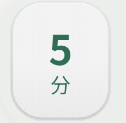
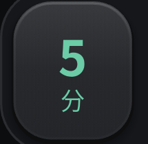
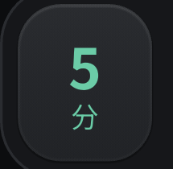
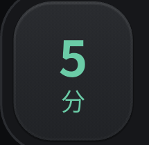

# PR #17 / #18 修复、真机复查与主线合并

**两项 P2 均在第一轮运行代码修复后通过回归，已按 #17 → #18 合入 main。** 用户在初审发现问题后明确授权“直接帮我优化修复好之后直接推进合并”；本轮不再等待另一轮合并确认。最初未通过的结论保留在[原审核记录](https://github.com/mhgd3250905/HipLab/blob/be782b74b3eefe782803aebf26b5224c33c0c3d7/docs/pr17-pr18-device-review-2026-10-18.md)，不改写历史证据。

| 对象 | 已核对事实（北京时间 2026-10-18） |
|---|---|
| [PR #17](https://github.com/mhgd3250905/HipLab/pull/17) | 修复 `0930892`，最终 head `4f29b7712825e672ef86abb43c295b49a6269653`；23:35:52 MERGED，merge `e98d0f10800327926569e22f8c47e825f48e64d3` |
| [PR #18](https://github.com/mhgd3250905/HipLab/pull/18) | 修复 `112ad78`，最终 head `6dd16eda246657d1de8ddf9e92b8e91d992c3a80`；在 #17 合入后 base 改为 main，23:36:26 MERGED，merge `aac4b1de3afb26a0f3d6e1d6718472e02ab31d72` |
| 当前运行内容 | 合并 main 与已构建/安装源 `6dd16ed` 的 lib/test/android/ios/assets/tools、依赖、版本及媒体 lock 完全相同；后续台账提交仅文档与证据图片，不重打包 |

## 修复与回归

F1：Tab 采用一个切换时钟，重定向前采样所有持久页面当前 opacity / dx，从当前画面继续淡出再淡入；不再按新 incoming/outgoing 身份重新解释旧进度。保留持久 slot、隐藏媒体/焦点/语义隔离、正常 fade-through 和减少动画无漂移。新增4项回归覆盖中途反向的透明度/位置连续性、三 Tab 快切和减少动画；原来的零时间跳变现在为0。

F2：分段控件显式管理按压、拖动、离开和取消状态，驱动共享滑块；滑块与文字同步0.97缩放，减少动画只改变材质。`HipPressable` 增加可选按压通知，其他调用不变；材质松开恢复与缩放统一为180ms。新增9项回归覆盖正常/减少动画、移出/取消、拖动取消、纵向滚动抢手势、键盘选中语义、180ms恢复及两个开始入口的实际首帧。

两项运行实现均只修一轮。专项分别22项、34项通过；独立交叉复核未发现新增确定问题。新增测试曾修正句柄清理与冗余导入，未因此再改运行实现。

| 验证对象 | 结果 |
|---|---|
| #17 固定修复分支 | analyze 0；全量 **169 pass / 1条件skip** |
| #17+#18 最终组合源6dd16ed | analyze 0；全量 **191 pass / 1条件skip**（VOICE_TIMELINE_OUT未设置） |
| gallery 模拟页 | 45/60改为小号分段，试听使用实际小按钮；合并main深浅生成 **2 pass**，更新图见[浅色](images/pr17-pr18-fixes-2026-10-18/gallery-light.png)、[深色](images/pr17-pr18-fixes-2026-10-18/gallery-dark.png) |
| 依赖 / 素材 / 发布配置 | pubspec.yaml、pubspec.lock、原生配置、assets及媒体lock相对入场main不变；未上传任何商店 |

## Android 原生复查与数据

同一2602BRT18C / Android16 / density520，先备份当前用户数据再 `adb install -r`，Success；回读0.3.6/code11，冷启动Status ok、1316ms。签名连续。**手机当前是本次修复包，尽管仍使用0.3.6+11版本号，其源码已由66f5da0/初审5711b42更新为6dd16ed。**

本次持按取证使用单个连续 Android pointer 流（原地1800ms，约550ms时截取），不使用分开进程发DOWN/UP的截图作为验收依据。浅色/深色首页选中分段、浅色语言分段和系统移除动画的分段均满足：按住与idle像素不同，松开后选中块回到idle的相同像素。减少动画下不缩放、仍改变材质，由原生画面和回归共同验证。快速Tab连点录屏、减少动画下训练/自测进入返回，以及正常模式视频播放中关闭已复查；抽帧未见视频黑块或脱离裁剪区。当前进程日志没有FATAL EXCEPTION或E/flutter标记。

| 分段材质 | idle | held |
|---|---|---|
| 浅色真机 |  |  |
| 深色真机 |  |  |
| 系统移除动画 |  |  |

Tab中途反向在同一虚拟时刻，修复后的前后帧保持一致（合成回归）：[切回前](images/pr17-pr18-fixes-2026-10-18/tab-before.png)、[切回后](images/pr17-pr18-fixes-2026-10-18/tab-after.png)。公开原生图片仅截取控件，不含健康记录；完整录屏及日志留本机。

本轮没有新增自测或训练打卡，没有清数据或恢复旧备份。浅色和系统动画值均已还原，安装前、安装后及全部复查后1356字节偏好逐字节一致，SHA-256 `b4ac5a3817155431b4a0b445fd12d8941852ea99fafd86956f0da153a505a5a4`。备份tar 4,204,032bytes、9 entries可读，既有记录保持。

## APK与证据身份

| 项目 | 值 |
|---|---|
| APK源码 | `6dd16eda246657d1de8ddf9e92b8e91d992c3a80` |
| 版本 / 包名 | 0.3.6+11 debug / com.ugk.hiplab |
| 本机APK | `E:/AII-3D/hiplab-releases/pr17-pr18-fixes-20261018/hiplab-0.3.6+11-pr17-pr18-fixed-debug-arm64.apk` |
| 大小 / SHA-256 | 150,903,412 bytes / `34bae5ac3a17a1906f390336e17292a5ba7078d0f822413c9a2a25e822286c0a` |
| 签名 | apksigner通过；debug证书SHA-256 `3761270a4764157f0e389014a9e5b800b05403bfddce0f4f7f8c039f6a53bdc7` |
| ABI | Flutter engine为arm64；APK另含插件的其他ABI JNI库 |
| 构建 | Gradle assembleDebug 49s；仅命令参数关闭Kotlin incremental并使用in-process编译，处理C盘工作副本/E盘pub缓存，不修改项目配置 |
| 本机证据 | 同目录的apk-identity.json、native-verification.json、pr17/combined分析测试日志、单项取证、录屏与before/after偏好；未进Git，不代表远端备份 |

低端机有效帧时、强光实屏辨识度、iPhone，以及不写假记录前提下的新自测结果页上升路径，仍保留原审核的待验边界。本轮只关闭已查实F1/F2及完成用户明确授权的主线集成，不把这些未执行项写成通过。
