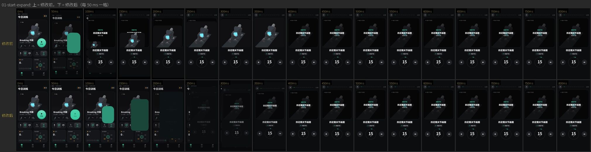

# 页面转场与 Hero 动画质量审计（2026-10-18）

分支 `fix/transition-quality`，基于 `origin/main` `ee83628`（0.3.6+11）。本轮只改转场，不改依赖、`pubspec.lock`、版本号和商店配置；未合入 main，未安装手机。

起因：用户反馈第二轮（`feat/polish-round2`）的按方位转场 + Hero 没认真测——主页「开始」按钮的 Hero 过渡太快、效果差，多个动画同时跳来跳去显得杂乱。本轮先逐帧看清每个转场，再改。

## 方法：逐帧捕获

- 工具：`test_screens/support/frame_capture.dart`（`FrameCapture`）+ 场景 `test_screens/hip_transition_capture_test.dart` + 渲染 `tools/transitions/render.py`。
- widget test 里真实触发（点按钮 / 推路由 / 左缘拖动），按 1000/60 ms 逐帧 `pump`，每帧在 `runAsync` 里用 `RepaintBoundary.toImage` 截 PNG（390×844 逻辑像素，2× 输出 780×1688），加载真实 NotoSansSC 字体；每个转场先无计时走一遍让图片解码，再正式录。
- 输出：每转场一个 PNG 序列 + `frames.json`（帧号/毫秒）、带帧号毫秒的拼图、60 fps 正常速与 0.25× 慢放 MP4；`--compare` 生成修改前/后同时刻对比拼图和并排视频，`--reel` 生成合集。
- 取舍：Hero、ClipPath、Opacity、Transform 在 widget test 截图里都能正常渲染，因此**不需要** Linux 桌面 + xvfb 录屏（沙盒也没有 xvfb）。代价：① 视频平台视图（Android/iOS 的原生 WebView 示范）在测试里由海报代替（`videoEnabled: false`）；② 阴影/模糊按测试渲染器绘制；③ 帧是理想时钟，不反映真机 GPU 掉帧。这三项列入真机清单。
- 「修改前」在 `origin/main` 的独立 worktree 上用同一场景文件录制，保证对比同一流程同一时刻。

复现：

```bash
CAPTURE_OUT=test/_shots/capture/after flutter test --no-pub test_screens/hip_transition_capture_test.dart
python3 tools/transitions/render.py test/_shots/capture/after
python3 tools/transitions/render.py --compare <before> <after> test/_shots/capture/compare
```

（`CAPTURE_THEME=light` 录浅色；输出目录 `test/_shots/` 已被 Git 忽略。）

## 盘点（修改前）

| # | 来源 → 目标 | 类型 | 时长 进/退 | 曲线 | 同时参与运动的元素 |
|---|---|---|---|---|---|
| 1/2 | 今日「开始」→ 训练页，关闭返回 | 容器展开 `expand`（起点 104 圆，r52，jade） | 380 / 320 ms | M3 `easeInOutCubicEmphasized` 双向 | 容器裁剪扩张；页面淡入 t .18–.7；jade 淡出 t 0–.55；**Hero** `drill-art-<首个动作>` 从 40 px 缩略图飞到播放器媒体区；首页缩小 6% + 变暗 45% |
| 8/9 | 进度页「2 分钟椅边放松」→ 训练页 | 容器展开（列表行，r12，`surfaceHigh`） | 380 / 320 | 同上 | 容器；首页（进度 tab）缩小变暗 |
| 10/11 | 自测 tab「开始自测」→ 体检页 | 容器展开（按钮，r28，jade） | 380 / 320 | 同上 | 容器；**Hero** `assess-art-<第1项>` 缩略图 → 示范区；**Hero** `assess-title-<第1项>` 标题文字飞到页头；被覆盖页缩小变暗 |
| 12 | 今日「我的髋部」磁贴 → 体检页（仅未自测时） | 容器展开（磁贴，r22，surface） | 380 / 320 | 同上 | 容器；被覆盖页缩小变暗 |
| 13/14 | 体检结果「开始训练」→ 训练页（无屏上起点） | 上升 `rise` | 360 / 300 | 进 `emphasizedDecelerate`，退 `emphasizedAccelerate` | 整页上滑；被覆盖页缩小 6% + 变暗；首页 tab 在树里时 `drill-art` Hero 也会飞 |
| 5/6 | 设置「隐私政策」「重新看安全提示」、阻断卡「重新选择安全提示」→ 详情 | 右推 `push` | 360 / 300 | 同上 | 新页右滑入；被覆盖页视差 -28% + 缩小 3% + 变暗 |
| 7 | 详情页 iOS 左缘右滑返回 | 手势 | 跟手，松手 ≥120 ms | 跟手线性，松手 `fastEaseInToSlowEaseOut` | 同 pop |
| 3/4 | 底部 Tab 今日 / 自测 / 进度 | `HipTabSwitcher` | 300 ms | `emphasizedDecelerate` | 新旧两页同时交叉淡化 + 各自 14% 横移 |
| — | 疼痛反馈、自测路线等底部弹层 | Material modal sheet | `HipMotion.sheet`（=page） | Material 默认 | 未捕获，本轮只随 page 时长变化 |
| — | 页内切换（播放器动作/阶段、自测题目） | `HipFadeSwitcher` / `AnimatedSwitcher` | 180–420 ms | — | 不属于页面转场，本轮未改 |
| — | `HipPageTransitionsBuilder`（普通 PageRoute 兜底） | 右推 | 同 push | 同 push | 目前没有调用方，曲线同步修改 |

全部 Hero tag：`drill-art-<id>`（首页第一个缩略图 ↔ 播放器媒体区）、`assess-art-<item>`（自测列表行缩略图 ↔ 体检示范区）、`assess-title-<item>`（列表行标题 ↔ 体检第 1 题标题）。

## 缺陷清单（逐帧看过拼图后写）



**1 今日「开始」→ 训练页（用户点名）**
- 感知速度：容器 83 ms 已扩到约 85% 全屏。M3 三点 emphasized 曲线在 1/3 时间内完成约 90%，380 ms 实际读成「~90 ms 一闪 + 290 ms 几乎静止」，所以觉得太快。
- 运动过多：同时有容器扩张、40 px 缩略图 Hero 放大约 9 倍飞向媒体区、首页缩小 6%，再加内容淡入，共三层空间运动。Hero 起点（卡片左下缩略图）和容器起点（右下按钮）不同，方向交叉。
- 终点跳变：Hero 飞行中媒体区是未变暗的亮图；383 ms Hero 结束的一帧突然换成带「准备开始」遮罩的暗图，明显闪变。
- 起点不连续：第 1 帧按钮的渐变、图标、「开始」字瞬间变成纯色块；首页同时缩小，按钮离开了容器起点。
- 双重曝光：33 ms 起页面就以约 35% 透明叠在 jade 上，文字和色块重叠。

**2 训练页关闭**：第 1 帧媒体区从暗遮罩跳成亮图（Hero 接管）；前约 230 ms 页面几乎不缩（反向 emphasized 慢启动），只有 Hero 在飞；最后约 80 ms 整页急速塌缩；317 ms 按钮先以纯 jade 出现，333 ms 才换回渐变和图标——终点跳变。

**3/4 Tab**：33 ms 时新页约 60% 不透明、旧页约 50%，两页文字叠在一起；首帧近似硬切，随后约 250 ms 旧页残影继续漂移。

**5 右推**：第 1 帧（17 ms）新页已跨过约 40% 屏宽（`emphasizedDecelerate` 起始斜率过大），读成跳切，之后 300 ms 只爬最后几十像素；被覆盖页视差、缩小、变暗三件事同时发生。

**6 返回**：前约 130 ms 几乎不动（加速曲线），最后 2–3 帧冲出屏幕，感觉「延迟后突然消失」，与进入不对称。

**7 iOS 右滑返回**：跟手、松手完成都正常，无缺陷（保留）。

**8/9 椅边放松**：同 1 的容器问题；起点颜色 `surfaceHigh` 与所在卡片 `surface` 不同，第 1 帧该行变成亮色块；行内文字瞬间消失。

**10/11 开始自测**：同 1 的容器问题；两个 Hero 从列表第 1 行飞出，而容器从底部按钮长出，起点不一致；标题 Hero「蝴蝶式」飞行中与「膝盖多高？」重叠并被缩放；383 ms Hero 落地后「点击暂停」等才出现（终点跳变）。

**12 我的髋部磁贴**：同 1 的容器问题；页面内容不随容器缩放，裁剪窗口先露出页面右下角（选项、下一项按钮），不是整页从磁贴长出。

**13/14 上升**：第 1 帧新页已升起约 40%；首页同时缩小、变暗；首页可见时 `drill-art` Hero 也会飞出，三层运动。

## 设计原则与修改

1. **一次转场只有一个主运动。** 被覆盖页不再缩放：右推时只做 iOS 式视差（-28%）+ 轻度变暗，上升 / 展开时只变暗（深色 32%、浅色 14%）。
2. **去掉全部 Hero。** 三组 Hero 都不是「点了谁，谁变成目标」的真连续共享元素（起点和容器起点不同），删除 `HipArtHero` / `HipTextHero` 及其 tag。
3. **「开始」等按钮 → 页面改为真正的容器变换**（`_ExpandTransition` 重写，同一时钟，关闭严格反向）：
   - 边界：起点矩形 → 全屏，`Curves.fastOutSlowIn`，约 175 ms 到一半、330 ms 到 90%；圆角随同一进度从起点半径收到 0。
   - 颜色：按钮色 → 页面背景，t 0.05–0.45。
   - 起点快照：`HipRoute.expandFrom` 对起点控件（现在各自包一层 `RepaintBoundary`）`toImageSync` 截一张图，第 0 帧与按钮完全一致，t 0–0.20 淡出；关闭时最后 20% 淡回，落在真按钮上无跳变。
   - 内容：t 0.35–0.85（扩展后半段）淡入，并按容器宽度等比缩放、顶部对齐，随容器整体长出，不再被裁剪窗口「揭开」。
   - 时长 500 ms，关闭 420 ms。
4. **曲线换成渐进型。** 进入用 `HipMotion.enter = Cubic(0.2, 0, 0, 1)`（17 ms 约 2%、100 ms 约 60%、200 ms 约 88%）；退出用 `fastOutSlowIn` 的翻转（100 ms 已走约 35%，不再先停后冲）。右推 / 上升 400 ms，返回 340 ms。iOS 左缘右滑跟手与松手逻辑不变。
5. **Tab 改为 fade-through**：旧页前 35% 时间内原地淡出；新页从 35% 起淡入，同时从点击方向漂入 8%。两页不会同时半透明。
6. **尊重「减少动态效果」**：`MediaQuery.disableAnimations` 为真时，所有页面转场改为纯淡入淡出，Tab 不再漂移（框架此时本来就把路由时长压到 5%）。
7. 椅边放松行的起点颜色改为所在卡片的 `surface`。

修改轮次：第 1 轮完成上述全部；第 2 轮微调两处——容器色过渡由 t .10–.55 提前到 .05–.45（第 1 轮 150–220 ms 有一大块饱和 jade，已改善）；Tab 新页淡入试过由 35% 提前到 30% 以去掉中间那一帧暗，但逐帧看 100 ms 处又出现两页各约 15% 的淡叠影，违背原则，撤回为 35%。两处都在两轮内收敛，没有换方案。

## 修改后（同一时刻对比）

| 转场 | 修改后实测 |
|---|---|
| 开始 → 训练页 | 第 0 帧与按钮一致；50% 面积约 175 ms；jade 200 ms 前转暗；内容 175–425 ms 随容器淡入；500 ms 落定，无 Hero、无终点跳变 |
| 关闭 | 内容先淡出，容器匀速收回，最后 20% 快照淡回，落在真按钮上 |
| 自测 / 磁贴 / 椅边放松 | 同一容器变换；无列表行 Hero；磁贴页从磁贴整体长出 |
| 右推 | 17 ms 起步约 2%，100 ms 约 60%，267 ms 约 96%，无跳切 |
| 返回 | 100 ms 走约 35%，200 ms 约 85%；末尾约 60 ms 有 ≤12 px 的边缘细条（减速尾），可接受 |
| Tab | 不再双重曝光；约 100 ms 有 1 帧两页都很淡（fade-through 固有，可接受） |
| 上升 | 只有新页上滑，首页仅变暗 |
| iOS 右滑 | 与修改前一致，跟手，松手约 50–80 ms 完成 |

对比图：`docs/images/transition-audit-2026-10-18/`（开始、关闭、Tab、右推、返回、开始自测）。全部 14 组对比拼图、并排视频和合集在交付目录，不入 Git。

## 测试

- `test/hip/hip_transition_test.dart`（新增 6 项）：push 首帧不跳、pop 及时起步且更快、expand 全程渐进且内容后半段淡入（含起点快照存在）、展开时下层只变暗不缩放、减少动态效果只淡入淡出、Tab fade-through 不出现两页同时半透明。
- `test/tools/frame_capture_test.dart`（新增 1 项）：捕获工具逐帧计时和文件输出。
- `test/hip/hip_ui_round2_test.dart`：原「共享元素」两项改为「开始 / 开始自测没有 Hero 同飞」两项。
- `flutter analyze` 0 问题；全量 165 通过 / 1 条件跳过（main 基线 158 + 新增 7）；四尺寸单屏自测回归在全量里照旧通过。

## 无头环境验证不了的部分

- 真机 GPU：展开期间整页 `Opacity`（saveLayer）+ `ClipPath` + `Transform.scale` 每帧重绘，中低端 Android 可能掉帧；90/120 Hz 屏的观感。
- 原生视频视图：训练中（示范视频在播）点关闭时，WebView 平台视图会随容器缩放、裁剪、淡出。修改前这段由 Hero 的静态替身遮住，现在是真视图参与变换，需真机看有无黑块、错位、闪烁。
- `toImageSync` 快照在 Impeller（iOS / 新 Android）上的表现；失败时自动跳过快照（只少了起点 20% 的按钮图案）。
- iOS 右滑返回的真实手感、系统「减少动态效果」开关。

## 给 Windows 安卓 agent 的真机验证清单

装本分支 debug 包（保留数据覆盖安装），深色、浅色各看一遍，慢动作可用开发者选项「动画时长缩放 5x」：

1. 今日「开始」→ 训练页：第一帧按钮不突变；绿色块平滑长大并转成页面背景，内容在后半段淡入；约 0.5 s 落定；没有缩略图飞行，落地后媒体区不闪。标准：无可见跳帧或闪变，整体不觉得快。
2. 训练页左上关闭（分别在「准备开始」和动作视频播放中各关一次）：页面收回按钮，按钮最后无跳变；**视频播放中关闭时视频区不黑块、不错位**。
3. 进度页「2 分钟椅边放松」→ 训练页并关闭：从该行长出，第一帧行不变亮。
4. 自测 tab「开始自测」→ 体检页并关闭；首次安装（未自测）时今日「我的髋部」磁贴 → 体检页。
5. 设置「隐私政策」「重新看安全提示」推入 / 返回键返回：起步不跳，返回不先停后冲。
6. 底部 Tab 来回快速切换（含连点）：不出现两页文字叠影，不报错、不白屏。
7. 完成一次自测后从结果页开始训练（上升）：只有新页上滑。
8. 系统设置开启「移除动画」（开发者选项动画缩放关闭 / 无障碍移除动画）：转场近乎瞬切或纯淡入淡出，功能正常。
9. 用 `adb shell dumpsys gfxinfo com.ugk.hiplab` 或 GPU 呈现模式条形图看第 1、2 项：可接受标准为转场期间无连续超过 2 帧的卡顿（janky frames 不集中在转场）。

iOS（Mac agent）补看：右推页左缘右滑返回跟手、半途松手回弹；第 1、2 项在真机上的观感。

## Windows复核修订：中途反向Tab连续性（2026-10-18）

按用户直接修复并推进合并授权处理F1，第1轮将Tab改为共享时钟，每次重定向从实际当前透明度和位移采样；保留持久slot、fade-through及媒体/焦点/语义策略。新增4项：零时间透明度与位移连续、三Tab快速重定向、减少动画无漂移。此固定分支analyze0，独立全量169pass/1条件skip；相关22项targeted通过。原失败证据在PR #17评论6251531461，修复后的组合Android原生验证与#18一起完成，不将本段写成已安装结论。未改依赖、lock、版本或商店配置。
