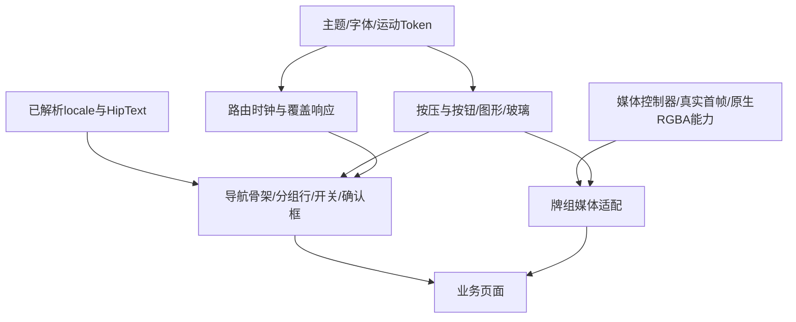

# 01 · 设计基础与组件边界

## 用一个清晰的层级组织界面

页面背景承载空间，浮动导航带承担可读性，卡片承担分组，少量控件承担可操作性。雕塑感主要给装饰图标和动作海报；主按钮、开关、返回键保持简单、可辨认。不能把所有东西都加玻璃、浮雕和投影。

这里的 pt 指 Flutter logical pixel，不是设备截图像素。安全区读取 `MediaQuery.padding`，键盘读取 `viewInsets`，不根据某台截图的状态栏高度写死 47。项目用真实 NotoSansSC 字体排版，测试默认 Ahem 不能当文字视觉基准。

## Token：从实际源码取值

来源：[HipPalette / HipColors / HipMotion](../../lib/hip/ui/hip_theme.dart)。下列为本次冻结值；移植到另一品牌可以成套换色，但不要保留名字、只随机改某几个页面颜色。

| 语义 | 浅色 | 深色 |
|---|---|---|
| background | `#F4F5F3` | `#0C0D0F` |
| surface | `#FFFFFF` | `#16171A` |
| surfaceHigh | `#EEF0EE` | `#1F2124` |
| text | `#121614` | `#F2F3F5` |
| muted | `#5D6661` | `#8C9096` |
| faint | `#9AA29E` | `#5B5F66` |
| jade（填充/图形） | `#14A37B` | `#3CCFA4` |
| jadeText（正文中的强调文字） | `#0D6E53` | `#3CCFA4` |
| onJade | 白 | `#07261D` |
| pain | `#D43F3F` | `#EF5A5A` |
| mediaBackdrop | `#EFEFEF` | `#101013` |

`faint` 是辅助信息色，不等于适用于所有字号的正文色。高对比度、可读性和真实内容仍需在接入 App 中检查；本表不是对任意背景的对比度合格声明。

浅色普通内容卡可用轻微的两层接触阴影；深色普通卡主要靠背景层级与细边区分。设置分组没有投影，返回胶囊也没有投影；确认框和分段滑块有各自规定的轻投影。不能把“统一设计”误解为所有组件同一阴影。

## 几何和文字：按组件用途区分

| 元素 | 几何 | 文字 |
|---|---|---|
| Topbar | 44；副标题时52；额外fade24 | 标题17/w600，副标题12 |
| 返回/关闭 | 44热区、32图形、左距16 | 语义名用当前语言 |
| 设置分组 | 外圆角10、组间28 | 不重复分组小标题 |
| 设置行 | 左右16/上下10，最小52/60 | 标题17/w400，副标题13，meta14 |
| 装饰图标 | 30槽位，后间隔12，文字起点58 | 自身不抢行语义 |
| 主/次按钮 | 普通50高/圆角14 | 主17/w600，次17/w500 |
| 开关 | 51×31视觉，51×44点击 | 有名字和开关状态 |
| 设置分段 | 显式32高/圆角9/inset2 | 13，选中w600 |
| 首页文件夹 | 64、外12/内6 | 数量来自真实数据 |

52/60是行的最小高度，不是截断英文的固定高度。英文标题最多两行，长标题与选择器可分两行；正文应增长。页面抬头为了不和返回按钮冲突会限制缩放，但不要把这种局部策略复制成整个 App 忽略文字缩放。

## 三种空间规则

```text
普通浮动导航页                         媒体叠牌
y=0 背景/滚动视口开始                  root overlay（同一媒体节点）
动态top + 44/52 标题行                  可越过首页标题和底栏
+24 fade，正文首屏在其下                最终按物理窗口裁剪
胶囊单独拥有44pt控制轨道                不被首页16pt padding截断

固定头部页：不再给正文重复加hipNavInset。
底操作条：自己负责bottom safe area，键盘高度由页面骨架补一次。
```

不能在需要内容穿透的正文外包一个顶部 SafeArea，再同时加 `hipNavInset`；不能在底操作条、页面和 LibFooter 三层重复补键盘高度。

## 动效 Token 与特定交互参数

| 交互 | 当前时序/曲线 |
|---|---|
| 通用按压 | 100ms按下、180ms恢复、scale .97 |
| 分段滑块 | 380ms（组件内部负责曲线与选中文字插值） |
| 页面进入/退出 | 400/340ms；enter `Cubic(.2,0,0,1)` / `exit.flipped` |
| 通用容器变换 | 500/420ms；`fastOutSlowIn` |
| 动作牌展开/收起 | 380ms；`easeOutCubic`，不是通用容器时长 |
| 推荐文件夹展开/收起 | 360/300ms；`easeInOutCubic` |
| 开关 | 200ms；`easeOutCubic` |

拖拽跟手阶段用手指的线性位移；松手阶段才切换到物理/缓动。不能给每个父子层各套一种主动画，再让文字、背景、媒体分别追赶。减少动画必须让状态和点击落到最终态，而不是只把动画时长改小、却留下透明遮挡层。

## 组件依赖与迁移层次



项目里的 import 图有交叉引用，不是一套已拆成上述目录的独立库。建议分三层迁移：

1. 先迁 token、字体、图形、按压与最小组件，连通目标 App 自己的主题/locale。
2. 再整体迁页面骨架与 route，按“页面表面/固定控制/覆盖控制权”合同接入，不单独复制一个返回圆按钮。
3. 最后接媒体适配与复杂动效。业务动作ID、scope、训练计划和AI配置由目标 App 继续拥有。

`hip_widgets.dart` 还包含 `HipDrillArt` 等 SDK 媒体代码，`hip_theme.dart` 导出项目的 theme choice；原样复制整个文件会带来额外依赖。可在目标 App 中做有界拆分，但这是移植工作，不是本仓库本次已完成的重构。不要声称改一下 package 名就能直接发布共享包。

## 主题与语言宿主

生产入口见 [HipApp._shell / _PaletteScope](../../lib/hip/ui/hip_app.dart)。MaterialApp 同时配置中英 delegates、supportedLocales、浅深 ThemeData；外层 Builder 在主题已解析的 context 下选 `HipColors.palette` 和状态栏图标亮度。切语言不换 Navigator 的 key，也不将 locale 纳入媒体身份。

当前 `HipColors` 是单 App 全局入口。多窗口或多个独立主题的目标应用应接入自己的 inherited token provider，而不是让两个窗口争用一个可变静态 palette。画廊仅以固定参数展示单个配色，不作为多窗口架构例子。

界面语言和口令语言是不同设置；用户命名、聊天历史原文不自动翻译。内容长短变化首先由布局承受，不要用 remount 页面/播放器来“刷新语言”。

## 素材与友善表达

功能图形保持清楚；列表前导图标可用统一立体插画。安全提示的人物采用明显卡通化五官和生活姿态，局部绿色暂停/暖黄绷带标记说明限制活动与暂时不适，避免把人的身份画成禁止对象。

透明图用 `contain` 保留人物和提示，深浅共用页面surface背景；不要为了填满卡片裁掉标记。素材与内容/许可由接入 App 自己确认。跨 App 复用的是这套表达方法与渲染合同，不默认复制 HipLab 的动作数据或SDK媒体资源。
